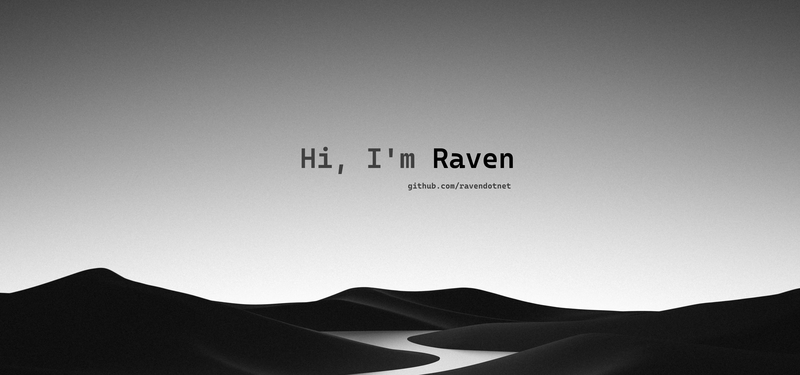

 

  
  &nbsp;&nbsp;  
  
  &nbsp;&nbsp;
  
  &nbsp;&nbsp;
  

 
 

<h2 align="center">about me</h2>

 
  Hello, I'm Keziah Zoe Plural, commonly known as "Raven".   Computer Science Student, aiming to be a Full-stack Programmer.  
  Had years of industry experience in multiple creative facets, now exploring technology and programming proficiency.   
  <i>"—a lifelong learner, mistakes can be the best teacher"</i>

  
<h3 align="center">techstack</h3>

  
  
  
  
  
  
  
  
  
  

 
 

<h3 align="center">projects</h3>

  
  
  
  

